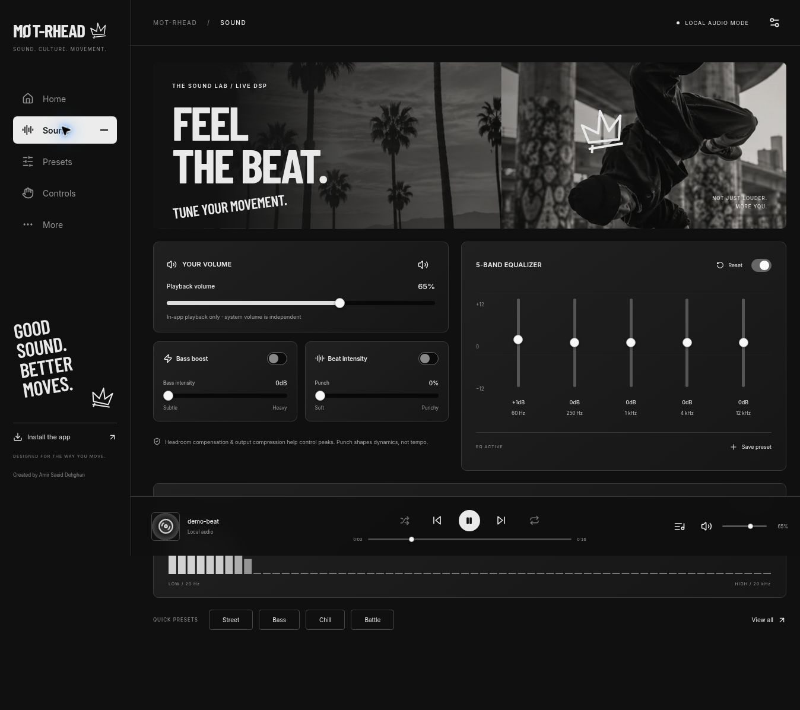

# MOT-RHEAD — Own The Noise

**Black. White. Bass. Culture. Movement.**

A premium, mobile-first, local-audio companion built for underground music culture. Real Web Audio processing, honest Bluetooth capability reporting, and a monochrome interface inspired by streetwear, skateboarding and breakdance.

Created by **Amir Saeid Dehghan**.

Repository: https://github.com/saaeiddev/Mot-rhead-

GitHub Pages: https://saaeiddev.github.io/Mot-rhead-/



## Start listening

1. Pair your headphones using your phone or computer's Bluetooth settings.
2. Open MOT-RHEAD, select **Import Music**, and choose browser-supported audio files. Or play **Concrete Frequency**, the included original demo beat.
3. Press Play. Open **Sound** to adjust playback volume, EQ, bass and punch.
4. Choose Street, Bass, Chill or Battle in **Presets**, or save your own sound. Custom presets can be renamed, updated and deleted.
5. Click the current track or library icon to open your named playlist, select/remove tracks, seek, enable shuffle, or cycle repeat off/all/one. Imported files are stored locally in IndexedDB when space is available.
6. Install from **More**. On iPhone Safari use **Share → Add to Home Screen**.

No account, analytics, remote audio uploads or third-party streaming authorization is required. File titles use the filename; artist labels identify local audio and the player uses original disc artwork rather than inventing embedded metadata.

Existing v0.1 sound settings and custom presets migrate automatically on first use. The previous release remains recoverable in Git history.

## Features

- Five complete sections: Home, Sound, Presets, Controls, More.
- Responsive desktop sidebar and mobile bottom navigation, safe-area spacing and keyboard-accessible controls.
- Local file import, persistent browser library and named playlist, play/pause, previous/next, seek, shuffle and three repeat modes.
- Five-band EQ at 60, 250, 1,000, 4,000 and 12,000 Hz; ±12 dB gain, bypass and reset.
- Genuine 110 Hz low-shelf bass enhancement and dynamics-based punch control.
- AnalyserNode spectrum from actual playback, frozen when paused, with reduced-motion support.
- Four real DSP presets and up to 50 persistent custom presets.
- Media Session transport controls when supported by the browser and OS.
- Optional generic BLE GATT connection; actual battery reads/notifications if the standard battery service is available and permitted.
- Offline PWA application shell; locally stored imported tracks can be played offline.
- Original headphone render, monochrome street-culture artwork, locally hosted fonts and original synthesized demo audio.

## Hardware and browser compatibility

| Capability | Status |
|---|---|
| EQ, bass, punch, mute and volume | Real processing of audio played inside MOT-RHEAD |
| System-wide EQ / Spotify / Apple Music / other apps | Not available; these streams never enter this audio engine |
| Bluetooth audio pairing/output | Managed by the operating system |
| Web Bluetooth | Optional, feature-detected; BLE GATT only, secure contexts and supported browsers |
| Standard Battery Service (`0x180F`), Battery Level (`0x2A19`) | Read and notifications only when actually exposed and permitted |
| ANC, transparency, hardware spatial audio | Unavailable without a documented manufacturer adapter; no fabricated commands |
| Headphone gesture remapping | Unavailable; the Controls page contains browser playback demos |
| iPhone Safari | Local player/DSP/PWA UI supported in compatible Safari releases; standard Web Bluetooth unavailable |
| Android Chrome / desktop Chrome and Edge | Local player/DSP supported; BLE depends on OS, browser, permissions and device |
| macOS Safari | Local player/DSP; no standard Web Bluetooth |

Real-device mode means **a successful GATT connection**, not confirmation of the audio output route. No battery percentage or connection success is simulated. The concept device in Home is explicitly labeled. Generic BLE selection cannot control arbitrary Bluetooth Classic headphones.

### Adapter architecture

`src/bluetooth/adapter.ts` defines `HeadphoneAdapter` and a standard `BatteryAdapter`. Add a model-specific adapter only after obtaining documented service/characteristic UUIDs, command payloads and safe device-matching rules. It must report discovered capabilities, handle disconnects, and never infer ANC or remapping support from a battery service. Current generic integration implements chooser cancellation, errors, a 15-second connection timeout, notification cleanup and late-connection cancellation.

## Audio implementation

The graph is:

`HTMLAudioElement → headroom gain → five EQ filters → 110 Hz bass shelf → punch compressor → output compressor → volume gain → analyser → destination`

The first/last EQ filters are low/high shelves; the middle bands are peaking filters with Q = 0.8. Parameter changes use 25 ms smoothing. Punch adjusts compression threshold/ratio/release with a 35 ms attack, preserving more transient attack. It does not change tempo or the composition's beat pattern.

Input headroom compensates the sum of positive filter boosts plus 1 dB. The final compressor has a -1 dB threshold, 20:1 ratio, 1 ms attack and 100 ms release. This reduces overload risk; it is not a mathematically guaranteed true-peak brick-wall limiter. Very large boosts intentionally reduce overall loudness. The visualizer reads the actual post-volume AnalyserNode data at up to 30 fps, or 4 fps with reduced motion.

## Development

Requires Node.js 22+ and npm. No API keys or backend are needed.

```bash
git clone https://github.com/saaeiddev/Mot-rhead-.git
cd Mot-rhead-
npm ci
npm run dev
```

Open the printed local URL with `/Mot-rhead-/`. In environments where binding all interfaces is unavailable:

```bash
npx vite --host 127.0.0.1 --port 5173
```

Commands:

```bash
npm test              # preset/storage safety and mocked BLE lifecycle tests
npm run build         # strict TypeScript check + production build + PWA shell
npm run preview       # preview production build
npx playwright install chromium
npm run test:e2e      # Chromium desktop/mobile app flows + real offline DSP renders
```

The development-only `/Mot-rhead-/tests/audio.html` provides an interactive real-DSP verification harness. `/Mot-rhead-/tests/responsive.html` embeds the app at 320, 390, 768 or 1024 px. These test pages are not included in the production build.

## Deployment

`.github/workflows/pages.yml` runs unit tests, TypeScript/build, Chromium desktop/mobile end-to-end tests, uploads the build artifact, and deploys through the official GitHub Pages actions.

One-time repository setting: **Settings → Pages → Build and deployment → Source → GitHub Actions**. If Pages is not enabled, the deployment job cannot create the site using the default workflow token; enable this setting and rerun the workflow. No repository rename or new repository is needed.

`vite.config.ts` explicitly sets `/Mot-rhead-/` as the base. The manifest's ID, start URL and scope use the same path. Navigation uses URL hashes, so refreshing sections does not request nonexistent server routes. All runtime fonts, scripts and visual assets are local. The generated service worker caches the app shell after its first successful online visit; the demo WAV is online-only. Imported audio is stored separately in IndexedDB.

## Source map

| Path | Purpose |
|---|---|
| `src/App.tsx` | Navigation, screens, local preferences, preset editor and device UI |
| `src/audio/engine.ts` | Reusable real Web Audio DSP graph |
| `src/audio/presets.ts` | Factory profiles, validation and headroom calculations |
| `src/audio/usePlayer.ts` | File playback, queue, repeat, shuffle and media session |
| `src/audio/library.ts` | IndexedDB file persistence |
| `src/bluetooth/adapter.ts` | Honest generic BLE/battery adapter and extension interface |
| `src/components` | Accessible sliders and actual audio spectrum |
| `src/styles.css` | Monochrome design, layout and reduced motion |
| `public/assets`, `public/icons` | Self-hosted app assets and PWA icons |
| `scripts/generate_demo.py` | Original demo audio source generator |
| `tests` | Unit, browser, DSP and responsive verification |
| `docs` | Screenshots, asset provenance and verification notes |

## Known limitations and verification

See [verification notes](docs/VERIFICATION.md) for performed checks and untested hardware/browser behavior.

- Actual headphones, battery notifications on hardware, iPhone audio output and background lock-screen behavior need physical-device validation.
- Codec support varies by browser. Unsupported files show an error; DRM-protected media is not supported.
- There is one named local playlist/library per browser, not a cloud library. Removing a track removes its local stored copy. Keep original files; browsers may evict storage or deny persistence in private sessions.
- Artist/album tag extraction and embedded cover art are not implemented. Filenames and labeled local/demo metadata are used.
- The headphone asset is a high-quality 3D-style product render with CSS motion, not a rotatable WebGL mesh.
- A PWA needs HTTPS (or localhost) for installation/service workers. Browser/OS installation menus vary.
- Manufacturer-specific hardware features are deliberately unavailable until a real adapter is implemented.

Future improvements: documented manufacturer adapters, multiple saved playlists, embedded metadata/cover extraction, physical-device QA and optional optimized interactive 3D models.

## Licensing

Application source and original project assets are retained for the repository owner. No blanket open-source license has been applied without the owner's choice. Dependencies retain their own licenses; see [asset provenance](docs/ASSETS.md) and package metadata. This is an independent project, not an official Skullcandy application.
